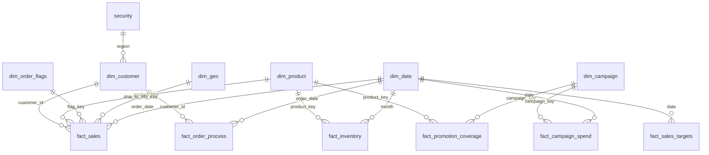

# Power BI Data Modeling: From a Messy 23-Table Dataset to a Clean Star Schema

## Business Context

A global B2B company (North America, Europe, Asia) sells products to corporate customers. Its source data covers customers, products, orders, invoices, payments, shipments, marketing campaigns, inventory, sales targets and user access. Reports built directly on the raw tables gave wrong totals and slow performance, so the task was to fix the model underneath.

## Objectives

- Convert a spider-web model into a star schema (a galaxy of facts sharing dimensions).
- Keep every total correct after every transformation.
- Remove unneeded columns and tables to reduce size and confusion.
- Apply naming standards and friendly values across the whole model.
- Add a date dimension, reusable measures and row-level security.

## Tools

Power BI Desktop, Power Query (M), DAX, data modeling concepts (grain, star schema, role-playing dimensions, junk dimensions, factless and accumulating snapshot facts).

## Source Data Summary (23 Tables)

| Area                    | Raw tables                                                                   | Issues found                                                                                                           |
| ----------------------- | ---------------------------------------------------------------------------- | ---------------------------------------------------------------------------------------------------------------------- |
| Customers and geography | customer_master, customer_contacts, user_details, addresses, cities, regions | one entity under two names (customer and user), several contacts per customer, headers in first row, test customer 999 |
| Products                | products, subcategories                                                      | duplicate products with different codes, test row, category and subcategory packed in one pipe-separated column        |
| Sales                   | orders 2025, orders 2026, order_line_items                                   | header and detail structure, one event split by year, legacy and empty columns, numeric channel codes                  |
| Billing and delivery    | invoices, invoice_lines, payments, shipments, sheet1                         | same money repeated across tables, sheet1 is an exact duplicate of shipments                                           |
| Marketing               | campaign_log, campaign_skus                                                  | static attributes mixed with daily transactions, product list stored as comma-separated text                           |
| Other                   | inventory, sales_targets, exchange_rate, security, dimension order           | months stored as column headers, unconnectable table, garbage table                                                    |

## Approach

1. **Prepare:** explored every table, identified business entities, and organized Power Query into Stage, Dimensions, Facts and Support folders. Raw tables stay untouched; every new table is a reference.
2. **Build dimensions:** grouped tables describing the same entity, merged them at the correct grain, cleaned them, and disabled the raw tables.
3. **Build facts:** created facts at the finest grain, added surrogate keys and tested the control total after every merge.
4. **Polish:** audited standards, built the date dimension, created measures, applied row-level security and ran final tests.

## Standards Used

- English only; snake_case for tables and columns.
- Prefixes `dim_` and `fact_`; keys created in the model end in `_key`, source ids keep their own names.
- One compact date format and sensible default summarization across the model.

## Key Modeling Decisions

| Problem                                                                     | Decision                                                                     | Why                                                        |
| --------------------------------------------------------------------------- | ---------------------------------------------------------------------------- | ---------------------------------------------------------- |
| Contacts merged into customers inflated rows                                | Kept only the primary contact                                                | Matches the customer grain (one row per customer)          |
| Orders and order lines are header and detail                                | Built the fact from the order lines and used the header for context and keys | Numbers live in the details; the header rolls up from them |
| Merge on product name raised total sales                                    | Removed two duplicate product rows using the source id                       | Name-based joins fan out when names repeat                 |
| Channel, status and priority are unrelated flags                            | Built a junk dimension with 14 rows                                          | One small dimension instead of three                       |
| Ship-to and bill-to cities                                                  | One dim_geo with an active and an inactive relationship                      | Role-playing dimension, no duplicated table                |
| Order, shipment, delivery, invoice and payment tables repeat the same money | One accumulating snapshot fact with all milestone dates                      | Business questions are about time between steps            |
| Campaign log mixes static and daily data                                    | Campaign dimension plus daily spend fact                                     | Dimension describes, fact records events                   |
| Campaign product list                                                       | Exploded into rows, converted to keys, loaded as a factless fact             | Bridge between campaign and product                        |
| Inventory months as columns                                                 | Unpivoted into product, month and units                                      | Dates must be values, not headers                          |
| Pre-aggregated order total in the header                                    | Removed                                                                      | Recalculate from line totals instead                       |

## Data Cleaning Highlights

- Removed test rows, duplicate rows and duplicate or garbage tables.
- Dropped hash keys, source ids, long text, empty columns and repeated attributes (single point of truth).
- Promoted headers, split columns by delimiter (into columns and into rows), unpivoted months, appended split tables.
- Fixed case mismatches and leading spaces before merges; used left joins only.
- Added a manual mapping table for channel codes and documented the maintenance risk.
- Validation: tracked line total, checked row counts (60 customers, 60 products), and used group-by counts to detect duplicates.

## Final Data Model

- 6 dimensions: dim_customer, dim_product, dim_order_flags, dim_geo, dim_campaign, dim_date.
- 6 facts: fact_sales, fact_order_process (accumulating snapshot), fact_inventory, fact_campaign_spend, fact_promotion_coverage (factless), fact_sales_targets.
- All relationships are one-to-many with single-direction filters from dimension to fact; no fact connects to another fact.
- dim_geo has an inactive bill-to relationship; dim_date plays several roles on the order process fact.

## Measures and Date Dimension

- `dim_date` is created with `CALENDARAUTO()` so it grows with the data.
- A `_measures` table holds Total Sales, Total Orders (distinct count of order id, because the fact is at line grain), Total Active Customers, Total Customers, and Average Order to Pay (days between order and payment).

## Row-Level Security

- The security table (user email and region) filters dim_customer, which filters both fact_sales and fact_order_process.
- Role `regional_access` uses `USERPRINCIPALNAME()` to match the signed-in user to their region.
- Tested with View as: a North America user sees only North America data, and totals drop accordingly.

## Results

- 23 messy tables reduced to 6 dimensions, 6 facts, 1 security table and 1 measures table.
- Control totals matched after every transformation.
- &#91;Add your own before and after numbers if you measured them, for example file size or refresh time. Leave this out if you did not measure.\]

## What I Learned

- **Know the grain first.** Say out loud what one row represents before merging or building anything. Wrong grain leads to wrong dimensions, duplicated rows and wrong totals.
- **Merge only when it is safe.** A merge is safe when the table you bring in sits on the "one" side (one-to-one, or one-to-many with that table as the "one"). A "many" table, such as customer contacts, duplicates the main table. Check cardinality in Model view or with Group By and Count Rows, and always use a left join.
- **Protect the numbers.** Pick a control total (line total) and recheck it after every merge. Text-based joins are risky: duplicate product names inflated total sales until the duplicate rows were removed.
- **Model header and detail correctly.** Build the fact at the detail level, where the numbers live, and use the header to supply keys and new dimensions. Do not build separate header and detail facts and link them together.
- **One source of truth for each field.** Source systems (OLTP) repeat the same information across tables to speed up their applications. In the BI model, store each piece of information once and reach it through keys.
- **Remove what reporting does not need.** Drop hash keys, source ids, long text and empty columns. Remove pre-aggregated columns (such as the header order total) when the lowest-level values are already available; recalculate from them instead.
- **Reshape for reporting.** Humans like months or years as column headers, but reporting needs them as values, so unpivot. Split delimited lists into rows and split packed columns into separate fields.
- **Enrich with care.** Use Enter Data (Home tab) to add a mapping, such as channel codes to friendly names. It is manual, so document it and check for new codes, or ask the source system to own the mapping.
- **Dimension or fact is decided by role, not data type.** A dimension describes the event and changes slowly (campaign budget, start and end dates). A fact is the event itself and keeps happening (daily spend, orders).
- **Choose the right fact type.** Use a transaction fact for line-level events. For the order process (order, ship, deliver, invoice, payment) the same money repeats in several tables and business users mostly ask about totals, so keep the amount once and build one accumulating snapshot fact with all milestone dates, with the order as the trigger. This answers the more valuable questions about time between steps. A factless fact holds only keys (dates optional) and no measures, such as the campaign to product mapping.
- **Use the helper patterns.** Junk dimension for unrelated flags, role-playing dimension for two cities or several dates, and a shared date dimension for comparing facts.
- **Never connect fact tables to each other.** Facts connect only through shared dimensions, with one-to-many relationships and filters running from dimension to fact.
- **Set standards first.** Decide language, naming convention, prefixes and key suffixes up front, then enforce them everywhere.

# Key Learnings & Modeling Notes

## 1. Understand Grain Before Merging

- Identify what one row represents in each table before merging.
- A merge is safe when the joining table has at most one matching row for each row in the main table.
- One-to-one and many-to-one relationships (from the main table's perspective) can preserve the main table's grain.
- Always check cardinality and row counts to ensure a merge does not duplicate the main table.

## 2. Maintain a Single Source of Truth

- OLTP systems may repeat information across tables to support transactional operations and application performance.
- In an OLAP model, descriptive information is maintained in appropriate dimensions and accessed through keys.
- Remove pre-aggregated columns when the underlying lowest-grain values are already available. Recalculate totals from detailed data.

## 3. Transform Data for Reporting

- Unpivot columns when periods such as years or months are stored as headers. Reporting models work better when these values are represented as rows.
- Split delimited lists into rows or columns where appropriate.
- Use Power Query's **Enter Data** feature (Home tab) to create manual mapping tables for missing business descriptions or code-to-label mappings. Document and maintain these mappings.

## 4. Understand Dimensions vs Facts

- A dimension describes a business entity or event through descriptive attributes.
- A fact records a business event or measurable activity.
- Decide whether a table is a dimension or fact based on its business role and grain, not simply its data types.

## 5. Choose the Right Fact Table Design

Business processes often follow a sequence of events:

`Order → Ship → Deliver → Invoice → Payment`

Each stage can have its own transaction records, dates and measures.

However, when the same monetary amount is repeated across these stages, storing it multiple times can create aggregation problems.

An **accumulating snapshot fact** can track the complete process in one row per order, storing the relevant milestone dates and the amount once.

This is particularly useful when business users want to analyse elapsed time between milestones, such as:

- Order to shipment
- Order to delivery
- Order to payment

## 6. Understand Factless Fact Tables

- A factless fact table captures relationships or occurrences without numerical measures.
- It typically contains dimension keys, with dates included when relevant.
- Example: a campaign-to-product mapping table that records which products are associated with each campaign.

## 7. Use Dimensional Modeling Patterns

- **Junk Dimension:** Combines unrelated low-cardinality flags and indicators into one dimension.
- **Role-Playing Dimension:** Reuses the same dimension for different business roles, such as ship-to and bill-to geography or multiple process dates.
- **Shared Dimension:** Allows multiple fact tables to use common dimensions for consistent reporting.

## 8. Connect Facts Through Shared Dimensions

- In a conventional star schema, fact tables do not directly connect to one another.
- Fact tables connect through shared dimensions.
- Use one-to-many relationships with single-direction filtering from dimensions to facts wherever appropriate.

## 9. Establish Modeling Standards

- Define naming conventions, table prefixes, key suffixes and language standards before building the model.
- Apply these standards consistently across dimensions, facts, columns and measures.

## Additional Power Query Note

**Manual Mapping Tables**

When source data contains cryptic codes or missing business descriptions, Power Query's Enter Data feature can be used to create a manual mapping table.

For example, numeric sales channel codes can be mapped to readable channel names.

Since these mappings are manually maintained, document them and review them whenever new source codes appear.
